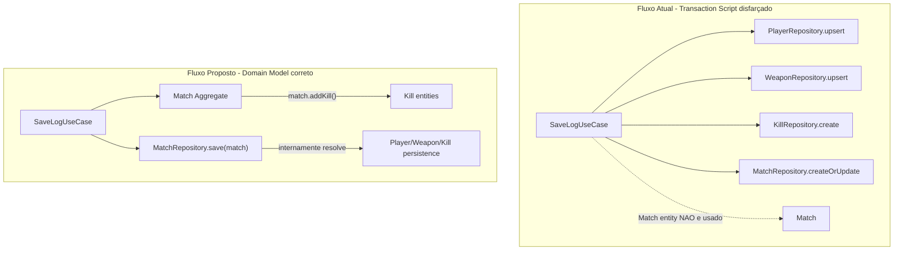

# Melhorar o padrao Domain Model (Vlad Khononov - Learning DDD)

## Qual padrao esta implementado?

O codebase implementa o **Domain Model** -- um dos padroes de logica de negocio descritos no capitulo 5 do livro. Ele esta combinado com a arquitetura **Ports & Adapters** (Hexagonal), com:

- **Aggregate Root**: `Match` contem `Kill[]` e encapsula logica de negocio (`getRanking()`, `addKill()`, `end()`)
- **Value Object**: `PlayerName` com validacao e factory method
- **Entidades**: `Kill`, `Player`, `Weapon` com validacao no construtor
- **Repository interfaces** (Ports) no dominio, implementacoes (Adapters) na infraestrutura
- **Use Cases** como Application Services orquestrando o dominio
- **Mappers** isolando dominio da persistencia

---

## Problemas identificados

### 1. O Aggregate Root e ignorado no fluxo de escrita

O problema mais critico. No `SaveLogUseCase`, a persistencia acontece entidade por entidade, **sem passar pelo Aggregate Root** (`Match`):

```34:96:src/modules/parser/use-case/save-log.use-case.ts
// O use case cria kills diretamente via repository
// sem jamais instanciar ou operar atraves do Match aggregate
await this.killRepository.create({ ... });
```

Segundo o livro (Cap. 6 - Aggregates), **todas as modificacoes devem passar pelo Aggregate Root**. O `Match.addKill()` existe mas nao e usado no fluxo de persistencia. O aggregate so e usado para leitura no `GetMatchRankingUseCase`.

### 2. Repositories operam em entidades individuais, nao no Aggregate

Os repositories atuais (`IKillRepository`, `IMatchRepository`) persistem entidades isoladas. Segundo o livro, **o Repository deve operar no Aggregate como unidade**:

- `IMatchRepository` deveria ter `save(match: Match)` e `findById(id): Match`
- `IKillRepository.create()` e `IKillRepository.exists()` nao deveriam existir separadamente -- a persistencia dos kills e responsabilidade do repository do aggregate

### 3. Concerns de persistencia vazam para o dominio

O `CreateKillPayload` no dominio contem IDs de banco de dados (`killerId`, `victimId`, `weaponId`):

```5:11:src/domain/repositories/kill-repository.interface.ts
export interface CreateKillPayload {
  matchId: bigint;
  killerId: number;   // <-- ID de banco
  victimId: number;   // <-- ID de banco
  weaponId: number;   // <-- ID de banco
  killedAt: Date;
}
```

O dominio deveria trabalhar com conceitos de dominio (nomes, value objects), nao IDs de banco.

### 4. Value Objects sao subutilizados

O `PlayerName` value object existe mas nao e usado dentro do `Kill`. A entidade `Kill` usa `string` para nomes:

```17:18:src/domain/entities/kill.entity.ts
private readonly _killerName: string;
private readonly _victimName: string;
```

Deveria ser `PlayerName` para garantir consistencia de validacao. O mesmo vale para `weaponName` que poderia ter um `WeaponName` value object.

### 5. O Use Case age como Transaction Script

O `SaveLogUseCase` contem logica procedural de orquestracao de baixo nivel (upsert player, upsert weapon, check exists, create kill). Segundo o livro, o use case deveria:

1. Carregar o aggregate
2. Invocar metodos do aggregate
3. Persistir o aggregate

---

## Plano de melhorias

### Passo 1: Fortalecer o Aggregate Match

Refatorar `Match` para ser um Aggregate Root completo que gerencia todo o ciclo de vida:

- Adicionar factory method `Match.start(id, startedAt)` para criacao
- Manter `addKill()` como unico ponto de entrada para adicionar kills
- Garantir que `Match` carregue seus kills quando reconstitudo do banco

**Arquivo**: [src/domain/entities/match.entity.ts](src/domain/entities/match.entity.ts)

### Passo 2: Redesenhar o Repository do Aggregate

Criar um unico `IMatchRepository` que opera no aggregate completo:

```typescript
export interface IMatchRepository {
  save(match: Match): Promise<void>;
  findById(id: bigint): Promise<Match | null>;
}
```

O `save()` deve persistir o `Match` e todos os seus `Kill[]` internos. A implementacao Prisma resolve os upserts de Player/Weapon internamente (na camada de infraestrutura, onde concerns de banco pertencem).

**Arquivos**:

- [src/domain/repositories/match-repository.interface.ts](src/domain/repositories/match-repository.interface.ts) - simplificar interface
- [src/infrastructure/persistence/prisma/repositories/prisma-match.repository.ts](src/infrastructure/persistence/prisma/repositories/prisma-match.repository.ts) - implementar save completo

### Passo 3: Eliminar repositorios de entidades filhas do dominio

Remover `IKillRepository` do dominio. A persistencia de `Kill` e responsabilidade interna do `PrismaMatchRepository`. O `IKillRepository` pode continuar existindo na infraestrutura como helper interno, mas nao como porta do dominio.

Para o `GetMatchRankingUseCase`, o `findByMatchId` de kills passa a ser `matchRepository.findById(matchId)` que retorna o aggregate completo.

**Arquivos a modificar**:

- [src/domain/repositories/kill-repository.interface.ts](src/domain/repositories/kill-repository.interface.ts) - remover ou internalizar
- [src/modules/ranking/use-case/get-match-ranking.use-case.ts](src/modules/ranking/use-case/get-match-ranking.use-case.ts) - usar `matchRepository.findById()`

### Passo 4: Usar Value Objects consistentemente

- Usar `PlayerName` dentro de `Kill` em vez de `string`
- Criar `WeaponName` value object
- O aggregate trabalha com value objects; a traducao para IDs de banco acontece exclusivamente no mapper/repository

**Arquivos**:

- [src/domain/entities/kill.entity.ts](src/domain/entities/kill.entity.ts) - usar `PlayerName` e `WeaponName`
- [src/domain/value-objects/player-name.vo.ts](src/domain/value-objects/player-name.vo.ts) - adicionar `equals()` e `toString()`
- Criar `src/domain/value-objects/weapon-name.vo.ts`

### Passo 5: Simplificar o Use Case

O `SaveLogUseCase` deve passar a:

1. Parsear o log
2. Para cada match: criar/carregar o aggregate `Match`
3. Adicionar kills via `match.addKill()`
4. Chamar `matchRepository.save(match)`

Toda a logica de upsert de Player/Weapon e resolucao de IDs migra para dentro do `PrismaMatchRepository.save()`.

**Arquivo**: [src/modules/parser/use-case/save-log.use-case.ts](src/modules/parser/use-case/save-log.use-case.ts)

### Passo 6: Remover concerns de persistencia do dominio

- Remover `PlayerRecord`, `WeaponRecord`, `CreateKillPayload`, `KillExistsParams` do dominio
- Esses tipos pertencem a camada de infraestrutura
- O dominio expoe apenas interfaces com conceitos de dominio

**Arquivos**:

- [src/domain/repositories/player-repository.interface.ts](src/domain/repositories/player-repository.interface.ts) - remover ou simplificar
- [src/domain/repositories/weapon-repository.interface.ts](src/domain/repositories/weapon-repository.interface.ts) - remover ou simplificar

### Passo 7: Atualizar testes

- Atualizar testes unitarios dos use cases para o novo fluxo
- Atualizar testes E2E se necessario
- Garantir que a logica de ranking continua funcionando via aggregate

---

## Diagrama: Fluxo Atual vs Fluxo Proposto




